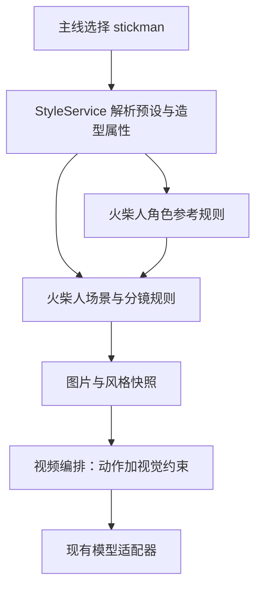

# 火柴人预设风格首版设计

日期：2026-10-14。代码核对基线：`13555d13` 及当前工作区；已有未提交改动不属于本设计。

状态：首版代码与本地定向验证已完成，尚未进行真实模型连续视频验收。用户已确认产品方向：一个“火柴人”风格，默认白底黑线，已增加可选的三种画风主题，详见 [主题扩展设计](stickman-style-themes.md)。

## 实施记录

- 已增加唯一的 `stickman` 虾格主线预设，以及用户指定的后端封面。
- 已传递 `character_representation` 属性，覆盖角色头像、四视图、复合参考、其他图片模型角色参考及主线分镜渲染中的人体/面部冲突规则。
- 主线单镜及批量视频共用的执行入口，在提供方调用前追加解析后的火柴人规则。
- 主线任务提交时保存风格与主题快照，执行和模型子进程沿用提交时的配置。
- 前端已有的 en、zh、vi 三种语言已补齐预设名称。沿用现有选择、预览和应用到项目交互。
- 当前验证使用提供方替身和浏览器实际页面；静态封面不能当作生成模型质量的验收证据。
- 封面使用用户提供的原始 PNG，保存在 `src/novelvideo/styles/presets/stickman.png`；保留原始像素，由现有封面容器居中裁剪。额外加入的虾画资源、模板及专用逻辑已删除。
- 清理额外虾画实现后复测：后端 81 项、前端 60 项定向测试通过；Ruff、TypeScript 与生产构建通过。构建仍提示较大 chunk。
- 浏览器验证：用户指定的本地项目风格页，在桌面 Chrome 中完成列表选择、预览、风格配置和 JSON 展开检查；新验收页控制台无 error/warn，未改变项目当前默认风格。远程 CI 与真实模型样例尚未执行。

## 1. 产品范围

在虾格主线项目风格选择中提供一个名为“火柴人”的条目，稳定标识为 `stickman`。本次实现不向虾画独立风格库注册模板。

- 主线：从角色参考、场景与道具、分镜渲染到视频请求，传递一致的火柴人视觉约束。
- 白色画布、黑色线条、二维平面造型；默认无彩色强调，明确要求时允许少量用于区分人物或表达信息的强调色。
- 沿用用户的语言、画幅、时长、模型选择与现有计费流程；风格本身不更换视频模型。
- 主题为可选项；缺省沿用白底黑线。其他不支持主题的预设不显示该控件。

## 2. 视觉与内容契约

| 对象 | 首版规则 |
| --- | --- |
| 人物 | 空心圆头，单线躯干与连接完整的线条四肢，稳定的头身关系和线宽；遮挡允许，不能用“必须看见四肢”破坏构图 |
| 表情 | 默认简洁，可按剧情使用少量线条表情；不生成写实五官、瞳孔和皮肤纹理 |
| 身份 | 保留姓名、关系、年龄语义、动作、位置、关键服饰与道具；以轮廓、简化配饰和相对体型区分角色 |
| 服饰 | 默认简洁；剧情指定的帽子、制服、发型等以少量轮廓表达，不固定成红帽黄衣 |
| 环境 | 白色基底，用黑色轮廓及简化空间线索表达剧情要求的地点、家具与道路；不以“极简”为由删除剧情需要的物体 |
| 材质 | 平面、清晰、无摄影皮肤、体积塑形、景深虚化与胶片颗粒；粗糙质感等剧情信息以符号表达 |
| 色彩 | 主体黑线、背景白色；有明确需求时采用少量一致的强调色，不将内部身份标记色误当作最终颜色 |
| 动作 | 每个时刻每条肢体只有一个姿态，动作不留下额外手臂；用道具或独立图形表现轨迹 |
| 文字 | 生成画面默认无字幕、水印和界面文案；已有字幕流程继续负责后期字幕 |

优先级：剧情决定“是谁、在哪里、做什么”，火柴人风格决定“如何画出来”。人体比例、皮肤和脸部细节等渲染要求应转换为简化表达；不能逐字复制与火柴人造型相冲突的描述。

真人或普通动画参考图提供身份与叙事线索，不要求复制其渲染材质。已生成的火柴人参考图则锁定头形、线宽、配饰与人物区别。已有参考图不会因切换风格自动覆盖；需要重新生成的资产沿用当前产品流程，并在验收时确认不会混用旧风格资产。

## 3. 已确认的代码约束

| 位置 | 当前行为及设计影响 |
| --- | --- |
| `src/novelvideo/styles/presets/*.json`、`services/style_service.py` | 主线预设由文件加载，可以增加 `stickman.json` |
| `models.py::StyleConfig`、`generators/prompt_builder.py::StyleConfig` | 存在两个不同的风格模型，新增运行时语义必须同步传递 |
| `generators/prompt_builder.py` | 渲染含有将火柴人草图归一为正常人体、自然肤色的规则；火柴人分支必须替换这些规则 |
| `generators/nanobanana_character.py` | 动画分支仍以正面脸部身份图和五官一致性为核心；仅标记 `animation/2d` 不足以支持火柴人 |
| `frontend/src/lib/visual-styles.ts` | 主线选择项及本地化映射需要显式增加条目 |
| `generators/video_generator.py` | 接受提示词与参考素材；风格约束应在请求编排层组装，不放入模型协议适配逻辑 |

## 4. 数据与调用链设计

### 4.1 主线预设

新增预设沿用已有字段：`id=stickman`、`label=火柴人`、`style_family=animation`、`animation_subtype=2d`，提供正向指令、避免指令和短风格标签。

建议增加 `character_representation` 字段，合法值为 `standard` 与 `stick_figure`，缺省为 `standard`。该字段控制角色造型规则，不承担主题、故事类型或模型选择职责。

- 在持久化风格模型、运行时风格模型、旧格式双向转换和服务返回值中保留该字段。
- 普通动画与真人预设缺省走 `standard`，维持原有行为。
- 火柴人预设写入 `stick_figure`；自定义风格按已有继承机制解析后保留该属性，不能只判断风格 ID。
- 查询不到风格时继续沿用现有错误或回退行为，不能用未知 ID 静默启用火柴人。
- 字段随已有风格 JSON 存储，无需新增数据库表或批量修改旧项目。

### 4.2 共享规则

主线预设承载标准视觉文案，后端集中组装火柴人的角色、渲染和动作约束，避免多处维护互相冲突的提示词。

虾格通过后端预设服务统一解析风格，不依赖虾画的模板清单和前端静态资源目录。

### 4.3 角色与分镜

火柴人角色参考保持已有资产类型、数量及下游读取契约，不新增独立角色库。对于当前需要头像的入口，生成简化头形与标志配饰；对于全身或复合参考入口，生成可辨认的线条人物。

火柴人分支需要覆盖普通提示词中的面部保真、肤色、正常人体比例、服装材质等相关段落。身份保持改为头形、轮廓、相对体型与关键配饰；民族和年龄等语义保留，但不要求用写实脸部表达。普通分支保留原有规则。

分镜继续锁定构图、机位、人物数量、姿态和道具位置。身份标记色只用于内部人物匹配，最终恢复预设黑线或明确指定的强调色。草图渲染与其他重绘路径均须覆盖，不能只修正一处 `REALISTIC PROPORTIONS` 文案。

### 4.4 视频

请求编排层将简洁的白底黑线、稳定线宽、保持简化人物与当前肢体姿态的约束加入视频提示词，并传递已有首帧或角色参考。逐镜动作仍由故事决定，不套用固定英文旁白、十秒片段或特定模型格式。

实施时须追踪主线的最终视频请求构建点，验证文本与素材实际到达提供方。仅检查预设文件存在或上游 prompt 含关键词不算接通。

## 5. 用户入口与资源

- 主线列表增加一个“火柴人”，不改变列表当前默认项，不自动迁移旧项目。
- 使用用户指定封面，不将其作为模型参考图。
- 主线预览接口读取后端预设同名 PNG，前端通过该 API 显示封面。
- 实施翻译时先读取工作区 `i18n-translate` 技能，按实际 locale 清单补齐名称和必要文案。本设计不新增主题开关或额外说明弹窗。

## 6. 决策记录

### ADR-1：一个风格，主题后续扩展

决定：保持 `stickman` 为唯一 ID。首版配色由预设固定为白底黑线。

替代方案：黑白两套独立预设。放弃原因：重复表达同一造型体系，后续维护与用户选择成本增加。

影响：后续主题切换沿用同一 ID，在需求明确后增加独立主题属性；缺省主题必须保持白底黑线，不在首版提前增加空字段。

### ADR-2：显式造型属性，复用现有动画链路

决定：以 `character_representation` 选择火柴人规则，并与现有 `animation/2d` 分类配合。

替代方案：仅增加文案，或在各生成器判断 `style_id == stickman`。前者无法消解冲突，后者不能可靠覆盖自定义继承风格。

影响：需要更新风格转换与传递合同；获得可测试的分支边界。首版仅支持两个值，不扩展通用人物造型框架。

### ADR-3：复用风格内容，沿用现有生成服务

决定：参考 Stickman Video Director 的视觉与连续性规则，使用虾格既有模型调用、时长、音频和任务流程。

替代方案：完整嵌入上游 Skill 的导演提案与生成工作流。放弃原因：本需求是预设风格，完整流程会额外引入审批阶段、旁白与模型假设。

影响：模型生成质量需由虾格自己的样例验收确认。直接复用上游实质性内容时保留 MIT 版权及许可声明；封面和演示图自行制作并记录来源，不直接使用社区作品。

## 7. 实施顺序与验证

| 阶段 | 交付 | 完成条件 |
| --- | --- | --- |
| 1 | 风格模型属性、转换与预设 | 加载、旧格式往返、自定义继承、普通风格缺省行为验证通过 |
| 2 | 角色、场景与分镜规则 | 各实际生成入口收到一致规则；火柴人不再携带正常人体/写实脸部要求；普通风格定向回归通过 |
| 3 | 虾格入口、后端封面 | 仅出现一个预设条目；保存重载一致；预览及详情资源可访问；多语言校验通过 |
| 4 | 视频编排与真实样例 | 验证提供方收到生效约束和参考；完成以下视觉验收并记录模型、参数与费用 |

自动验证包括：`test_api_styles.py`、`test_style_template_manifest.py`、`test_prompt_style_ethnicity_layering.py`，新增造型传递及相互冲突规则的定向回归；运行相关角色、分镜与视频请求合同测试。前端复用预设标签、风格节点同步、模板接口和资源地址相关测试。实施新增改动后再按仓库 CI 执行必要构建与检查。

模型验收采用一个连续三镜故事，分别使用 `16:9` 和 `9:16`，覆盖单人、双人互动与明确方向的动作。先验收参考图和分镜，再生成视频，减少无效调用。

- 仍是白底黑线平面火柴人，不出现普通人体、写实皮肤或意外三维体积。
- 双人身份可辨，人数和关键道具正确；连续镜头的头形、线宽与配饰稳定。
- 动作不增加肢体；允许合理遮挡，不能靠强行展示所有肢体破坏姿态。
- 场景和叙事可读，文字与字幕策略符合既有流程；参考风格在视频中保持。
- 记录失败样例与重试次数；不得以单张成功图代替连续视频验收。

## 8. 风险、成本与交付边界

生成模型仍可能产生肢体错误和跨镜头漂移，提示词不能保证一致性。用经过验收的参考图、简洁动作和定向重试降低失败成本；首版不引入新评分服务或自动重试预算。

接口与资产数量沿用现有合同，预设解析没有新增外部服务。视频费用仍取决于实际模型、时长和重试次数，不能因为画面简单而承诺更便宜。

本设计不需要修改 gateway 协议或部署拓扑。

代码已在 `feat/stickman-style` 本地实现；尚未调用付费模型、提交、推送或部署。本地测试、真实模型样例和远程 CI 应分别报告。
